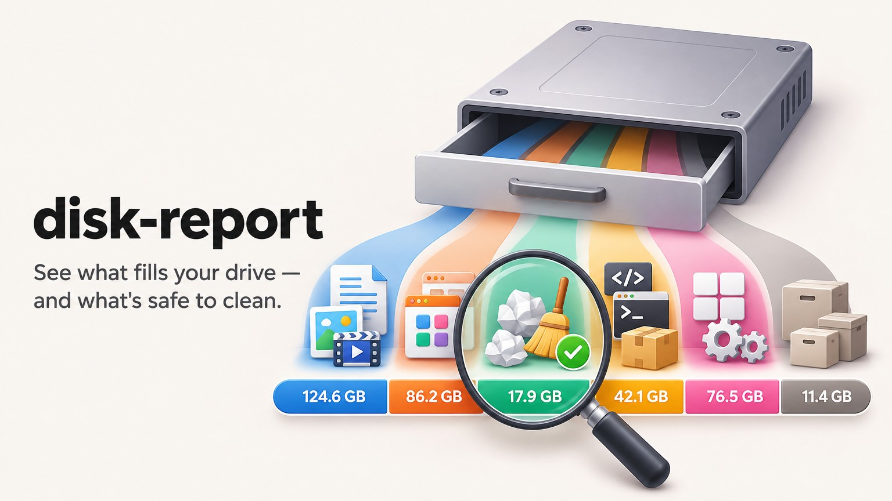
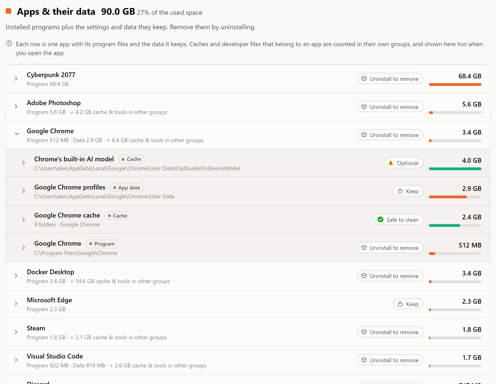

<p align="center">
  
</p>

<p align="center">
  <b>Find out what's really filling your Windows drive, and what you can safely delete.</b><br>
  One scan, one readable report. Nothing is ever deleted for you.
</p>

<p align="center">
  
  
  
  
  
</p>

---

Tools like WizTree and WinDirStat tell you *which* folders are big. They don't tell you what
`AppData\Local\NVIDIA\DXCache` is, whether `.gradle` can go, or why `C:\Users\you` takes 240 GB
when your documents are only 50 GB.

**disk-report** answers those questions. It scans the drive once and sorts every byte into six
groups (your files, apps and their data, caches, developer tools, Windows, other), then tells you
for each item:

- **what it is**, in plain words
- **whether it's safe to delete**: safe to clean, optional with a trade-off, your files, uninstall
  to remove, keep, or unknown
- **how to clean it**: the exact setting, menu or command, with a Copy button


<sub>Screenshots in this README use made-up data.</sub>

## Quick start

1. Install [Python 3](https://www.python.org/downloads/) (3.9 or later) if you don't have it.
2. Download this repository (**Code → Download ZIP**) or clone it:
   ```
   git clone https://github.com/znissou/disk-report.git
   ```
3. Double-click **`Disk Report.cmd`**.

The scan takes one to three minutes. The report opens in your browser and is saved in `reports\`.
It's a single HTML file that works offline, so you can keep it to compare with a later scan.

> Right-click `Disk Report.cmd` → **Run as administrator** to also measure System Restore points
> and a few protected folders.

From a terminal:

```
py disk_report.py              # scan C: and open the report
py disk_report.py --drive D    # scan another drive
py disk_report.py --no-open    # save the report without opening it
```

## What's in the report

**Every item explains itself.** Open any row to see what it is, what to do about it, what's
inside, which file types it holds, how old they are, and its biggest files.


**Apps come with their data.** Each app shows its program files plus the settings, caches and
downloads it keeps elsewhere, so you know what uninstalling it would free.



**Quick wins first.** Caches and leftovers that can go without losing anything are listed
together, biggest first.


It also finds:

- **Rebuildable project folders**: `node_modules`, Python `.venv`, `build`, `.next`, `.dart_tool`,
  `target`… across all your projects
- **Leftovers**: data of apps you uninstalled, program folders no installed app points to, old IDE
  versions, Python installs Windows no longer knows about
- **Unused Android emulator images**, matched against your emulators
- **Duplicate files and folders** in your own folders, with synced copies (OneDrive, Synology…)
  marked
- **Space the scan can't see**: restore points and file-system data, so the totals add up to
  what Windows reports

Light and dark themes follow your Windows setting.


## Safety labels

| Label | Meaning |
| --- | --- |
| **Safe to clean** | Deleting it loses nothing: it's rebuilt or downloaded again (caches, temp files, build outputs). |
| **Optional** | It can go, with a trade-off explained in the item (AI models download again, an emulator is lost, a venv must be rebuilt). |
| **Your files** | Only you can tell what's still needed. |
| **Uninstall to remove** | Remove the app in Settings → Apps instead of deleting its folders. |
| **Keep** | Needed by Windows or by an app you use. |
| **Unknown** | Not recognised. Check what it is first. |

## How it works

- **One fast pass over the drive.** Pure Python (`os.scandir`), about 3 million files in under two
  minutes on an SSD. Sizes are size on disk.
- **Counted once.** Windows files that appear both in `WinSxS` and `System32` (hard links) are
  counted once. Online-only cloud files are skipped because they use no local space. Junctions and
  symlinks aren't followed.
- **A knowledge base of folders.** [`catalog.py`](catalog.py) holds more than 300 rules for known locations:
  browser, GPU and package-manager caches, SDKs, emulators, Docker and WSL disks, Windows
  components, and app data. Each rule says what the folder is, how safe it is, and how to clean it.
- **Windows' own list of apps.** Installed programs (from the registry) and Store apps link program
  folders and app data to the app they belong to, and expose folders nothing points to any more.
- **Projects are detected by their files.** `build` counts as rebuildable only next to a
  `pubspec.yaml`, `build.gradle`, `CMakeLists.txt`…; `target` only next to a `Cargo.toml` or
  `pom.xml`, and so on.
- **Duplicates.** Files of 20 MB or more with the same size and identical content at the start,
  middle and end; folders with exactly the same file list.

## Teach it a new folder

Add a rule to `RULES` in [`catalog.py`](catalog.py):

```python
R(r"%LOCAL%\SomeApp\Cache", "SomeApp cache", CACHE, SAFE,
  "Images and data SomeApp saved to load faster.",
  "Close SomeApp and delete the folder; it's rebuilt automatically.", "SomeApp"),
```

Paths can use `~`, `%LOCAL%`, `%ROAMING%`, `%PD%` (ProgramData), `%PF%`, `%PF86%`, `%WIN%` and `*`
wildcards. Pull requests with new rules are welcome.

## Privacy

Everything runs on your PC and nothing is sent anywhere. The scan reads file names, sizes and dates.
The only contents it reads are Android emulator settings files and samples of the large files it
compares when looking for duplicates. Reports contain your folder and file names, so `reports/` is
git-ignored.

## Limitations

- Windows only.
- "Probably left over" and app matching are based on folder names. Check before deleting.
- Without administrator rights, System Restore points and a few protected folders are counted under
  "Space the scan can't see" instead of being measured.

## License

[MIT](LICENSE)
