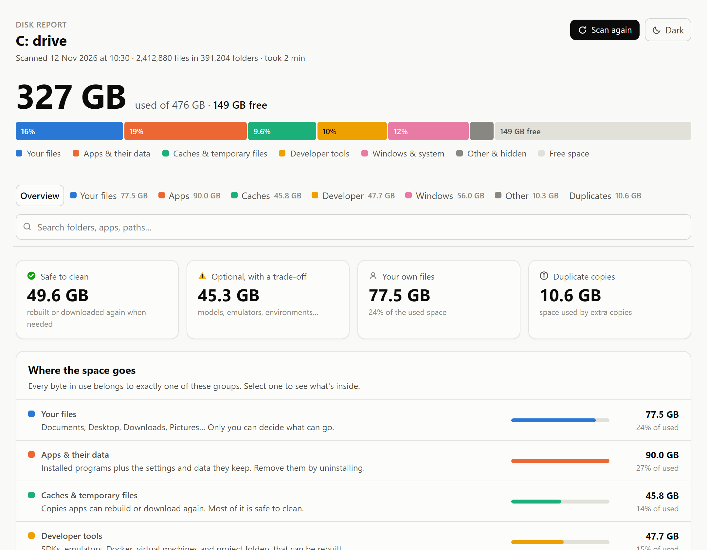
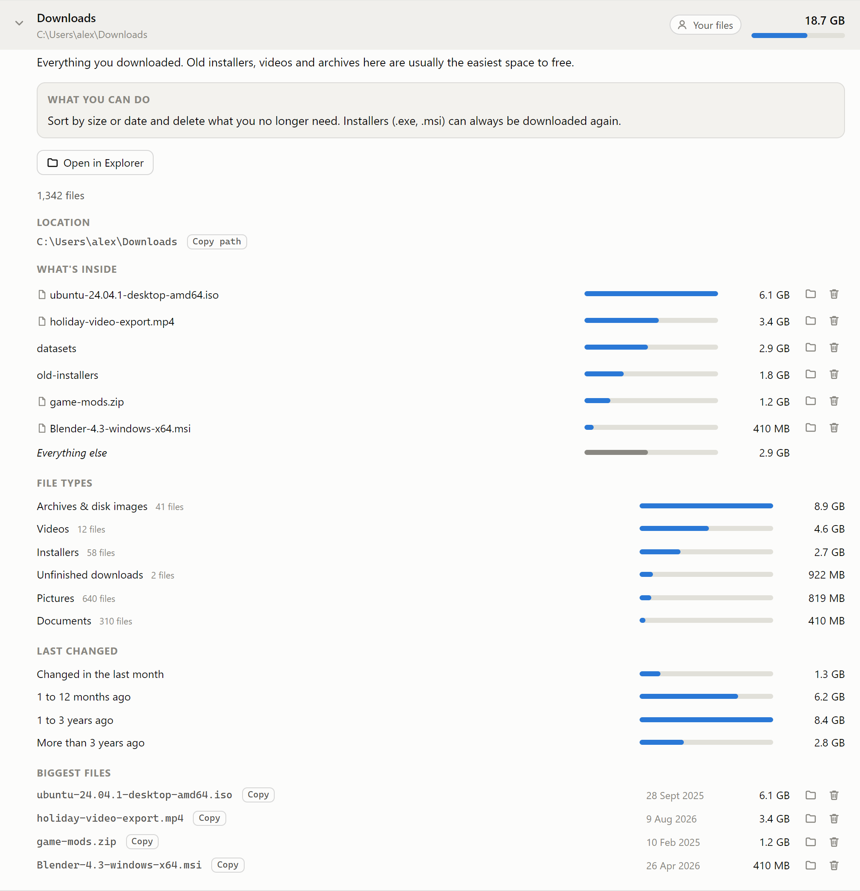
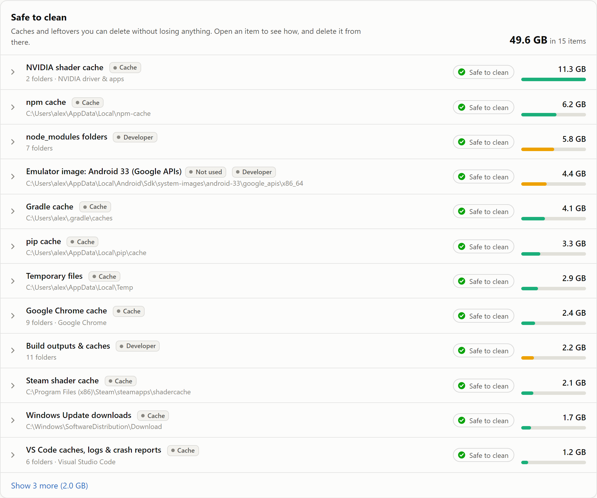
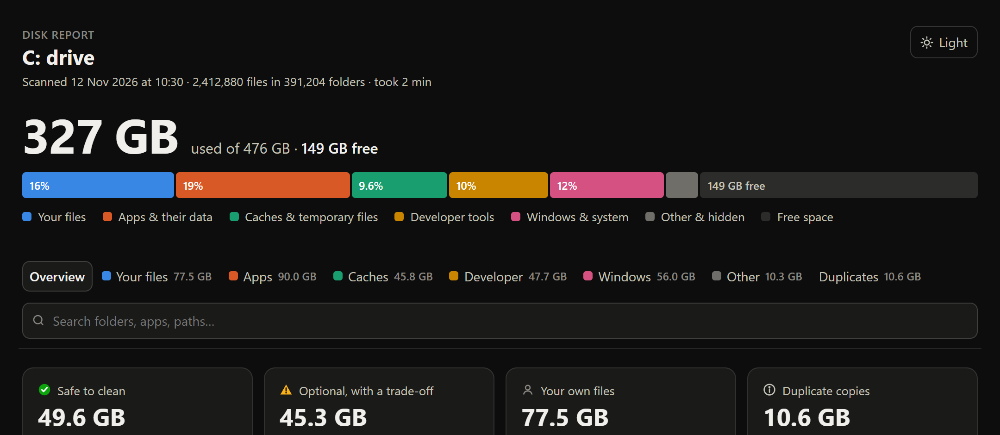

<p align="center">
  
</p>

<p align="center">
  <b>Find out what's really filling your Windows drive, and what you can safely delete.</b><br>
  One scan, one readable report, and a button next to each thing to act on it.
  Nothing is deleted unless you click and confirm.
</p>

<p align="center">
  
  
  
  
  
</p>

---

Tools like WizTree and WinDirStat tell you *which* folders are big. They don't tell you what
`AppData\Local\NVIDIA\DXCache` is, whether `.gradle` can go, or why `C:\Users\you` takes 240 GB
when your documents are only 50 GB.

**disk-report** answers those questions. It scans the drive once and sorts every byte into six
groups (your files, apps and their data, caches, developer tools, Windows, other), then tells you
for each item:

- **what it is**, in plain words
- **whether it's safe to delete**: safe to clean, optional with a trade-off, your files, uninstall
  to remove, keep, or unknown
- **how to clean it**: the exact setting, menu or command, with a Copy button



<sub>Screenshots in this README use made-up data.</sub>

## Install

Download **`DiskReport-Setup-<version>.exe`** from [Releases](https://github.com/znissou/disk-report/releases)
and run it. It installs for your account only (no administrator rights needed) and adds **Disk Report** to the
Start menu. Prefer nothing to install? Take **`DiskReport-<version>-portable.zip`**, unzip it anywhere and run
`Disk Report.exe`.

> The app isn't code-signed, so the first time Windows may say **"Windows protected your PC"**. Click
> **More info → Run anyway**.

Open the app and click **Scan C: now**. The scan takes one to three minutes. After that the app opens on your
latest report; click **Scan again** whenever you want a fresh one. Each PC keeps its own scans.

## Act on what you find

Open any item to see what it is, and act on it right there, one thing at a time:

- **Open in Explorer** the folder, or any file or folder listed inside it.
- **Delete** a cache, a leftover, a big file, an extra copy of a duplicate. You choose **Move to Recycle Bin**
  (you can restore it) or **Delete permanently** (the space is freed now). Caches are emptied in place: the
  folder stays and the app fills it again when it needs to. Files in use are skipped and counted; if Windows
  needs administrator rights for some of them, the app offers to finish as administrator.
- **Uninstall** an app: the app's own uninstaller starts, as it would from Settings → Apps. Disk Report notices
  when the app is gone, and its leftover folders can then be deleted too.
- **Run** a cleaning command from the catalog (`npm cache clean --force`, `docker system prune`,
  `powercfg /h off`…) in a terminal window you can follow and answer.
- **Empty the Recycle Bin**, or open the Windows Settings page an item talks about.

What the app never does:

- Nothing happens on its own. Every action is for one item and starts only after you confirm it.
- It never deletes Windows, Program Files, ProgramData, AppData, your user folder or the Documents,
  Downloads, Desktop… folders themselves (only things inside them), nor anything labelled **Keep**.
- It never deletes the folders of an app that's still installed: you uninstall the app instead.
- When a folder you delete holds something Windows or an installed app needs, that part is left alone and
  you're told so.
- Everything you do is written to `%LOCALAPPDATA%\Disk Report\actions.jsonl`.

> Right-click Disk Report → **Run as administrator** to also measure System Restore points and a few
> protected folders.

## Command line and running from source

The scan also works as a single report, without the app. Install [Python 3](https://www.python.org/downloads/)
(3.9 or later), download this repository, and double-click **`Disk Report.cmd`**, or from a terminal:

```
py disk_report.py              # scan C: and open the report
py disk_report.py --drive D    # scan another drive
py disk_report.py --no-open    # save the report without opening it
```

The report opens in your browser and is saved in `reports\`. It's a single HTML file that works offline, so
you can keep it to compare with a later scan. The command line needs nothing but Python.

To run the app from source: `py -m pip install -r requirements.txt`, then `py app.py`.

## What's in the report

**Every item explains itself.** Open any row to see what it is, what to do about it, what's
inside, which file types it holds, how old they are, and its biggest files.



**Apps come with their data.** Each app shows its program files plus the settings, caches and
downloads it keeps elsewhere, so you know what uninstalling it would free.


**Quick wins first.** Caches and leftovers that can go without losing anything are listed
together, biggest first.



It also finds:

- **Rebuildable project folders**: `node_modules`, Python `.venv`, `build`, `.next`, `.dart_tool`,
  `target`… across all your projects
- **Leftovers**: data of apps you uninstalled, program folders no installed app points to, old IDE
  versions, Python installs Windows no longer knows about
- **Unused Android emulator images**, matched against your emulators
- **Duplicate files and folders** in your own folders, with synced copies (OneDrive, Synology…)
  marked
- **Space the scan can't see**: restore points and file-system data, so the totals add up to
  what Windows reports

Light and dark themes follow your Windows setting.



## Safety labels

| Label | Meaning |
| --- | --- |
| **Safe to clean** | Deleting it loses nothing: it's rebuilt or downloaded again (caches, temp files, build outputs). |
| **Optional** | It can go, with a trade-off explained in the item (AI models download again, an emulator is lost, a venv must be rebuilt). |
| **Your files** | Only you can tell what's still needed. |
| **Uninstall to remove** | Remove the app in Settings → Apps instead of deleting its folders. |
| **Keep** | Needed by Windows or by an app you use. |
| **Unknown** | Not recognised. Check what it is first. |

## How it works

- **One fast pass over the drive.** Pure Python (`os.scandir`), about 3 million files in under two
  minutes on an SSD. Sizes are size on disk.
- **Counted once.** Windows files that appear both in `WinSxS` and `System32` (hard links) are
  counted once. Online-only cloud files are skipped because they use no local space. Junctions and
  symlinks aren't followed.
- **A knowledge base of folders.** [`catalog.py`](catalog.py) holds more than 300 rules for known locations:
  browser, GPU and package-manager caches, SDKs, emulators, Docker and WSL disks, Windows
  components, and app data. Each rule says what the folder is, how safe it is, and how to clean it.
- **Windows' own list of apps.** Installed programs (from the registry) and Store apps link program
  folders and app data to the app they belong to, and expose folders nothing points to any more.
- **Projects are detected by their files.** `build` counts as rebuildable only next to a
  `pubspec.yaml`, `build.gradle`, `CMakeLists.txt`…; `target` only next to a `Cargo.toml` or
  `pom.xml`, and so on.
- **Duplicates.** Files of 20 MB or more with the same size and identical content at the start,
  middle and end; folders with exactly the same file list.
- **The app** shows the same report in its own window ([pywebview](https://pywebview.flowrl.com/), using
  the Edge WebView2 engine built into Windows). Scans are kept in `%LOCALAPPDATA%\Disk Report`. Before any
  delete, [`actions.py`](actions.py) checks the path against the scan and the rules above, again.

## Teach it a new folder

Add a rule to `RULES` in [`catalog.py`](catalog.py):

```python
R(r"%LOCAL%\SomeApp\Cache", "SomeApp cache", CACHE, SAFE,
  "Images and data SomeApp saved to load faster.",
  "Close SomeApp and delete the folder; it's rebuilt automatically.", "SomeApp"),
```

Paths can use `~`, `%LOCAL%`, `%ROAMING%`, `%PD%` (ProgramData), `%PF%`, `%PF86%`, `%WIN%` and `*`
wildcards. A command written in backticks gets a **Run** button in the app when it's also listed in
`COMMANDS`, at the end of the catalog. Pull requests with new rules are welcome.

## Build the app

```
py -m pip install -r requirements-build.txt
py build.py
```

`dist\` then holds the app folder, the portable zip and, when [Inno Setup](https://jrsoftware.org/isinfo.php)
is installed, the installer. `py -m unittest discover tests` runs the tests of the delete rules.

## Privacy

Everything runs on your PC and nothing is sent anywhere: neither the scan nor the app connects to the
internet. The scan reads file names, sizes and dates. The only contents it reads are Android emulator settings
files and samples of the large files it compares when looking for duplicates. Reports contain your folder and
file names, so `reports/` is git-ignored, and the app keeps its scans in your own AppData folder.

## Limitations

- Windows only.
- "Probably left over" and app matching are based on folder names. Check before deleting.
- Without administrator rights, System Restore points and a few protected folders are counted under
  "Space the scan can't see" instead of being measured.
- The app isn't code-signed yet, so Windows SmartScreen warns the first time it runs.

## License

[MIT](LICENSE)
